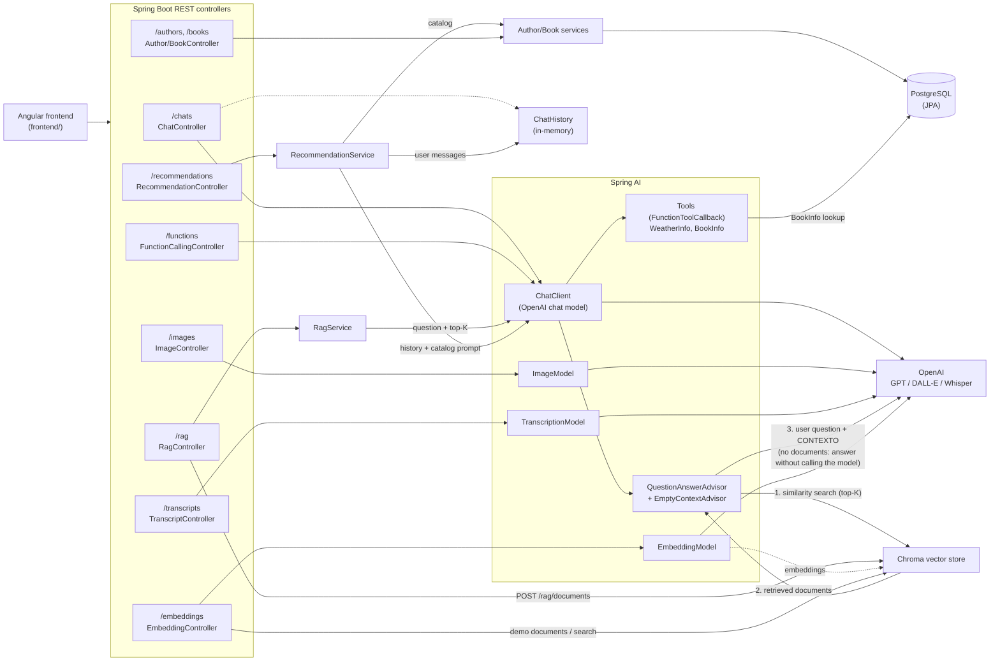

# AI Integration Spring Boot Backend

[](https://github.com/AZapata27/ai-integration-springai/actions/workflows/ci.yml) [](https://scorecard.dev/viewer/?uri=github.com/AZapata27/ai-integration-springai)

A Spring Boot backend (with an Angular client in `frontend/`) that shows how to integrate LLMs with Spring AI: chat, prompt templates, structured output, retrieval augmented generation over a Chroma vector store, function calling, image generation and speech-to-text.

## 🚀 Features

- **Chat**: plain prompts, prompt templates, structured output parsed into Java records, and a multi-turn conversation kept in memory (`/chats`). Uses OpenAI (`gpt-3.5-turbo`) through Spring AI's fluent `ChatClient`; structured output uses `.entity(...)`.
- **RAG (Retrieval Augmented Generation)**: documents are embedded and stored in Chroma; `/rag/ask` uses Spring AI's `QuestionAnswerAdvisor` to retrieve the top-K most similar documents and add them as context to the prompt sent to the model. If nothing relevant is retrieved, the model is not called.
- **Function Calling**: the model can invoke Java functions registered as Spring AI tools (`FunctionToolCallback`: `WeatherInfo`, a mock; `BookInfo`, which looks up a book review in PostgreSQL and reports "not found" when the book does not exist).
- **Book recommendations**: recommends books from the stored catalog (with their author and a reason) based on the user messages of a conversation kept in memory. Titles the model returns that are not in the catalog are discarded.
- **Embeddings**: generate embeddings for a text and run a similarity search against the vector store.
- **Image Generation**: DALL·E 2 / DALL·E 3 images from a text prompt (URL or base64).
- **Speech-to-Text**: Whisper transcription of bundled sample audios and of uploaded audio files.
- **Authors and books CRUD**: persisted in PostgreSQL with Spring Data JPA, seeded from `src/main/resources/json/` on startup.

## 🛠️ Tech Stack

- **Java 21**, **Spring Boot 3.5**, Maven wrapper
- **Spring AI 1.1** (BOM `spring-ai-bom`, artifacts from Maven Central): `ChatClient`, OpenAI chat, embedding, image (DALL·E) and transcription (Whisper) models, tool calling, `QuestionAnswerAdvisor`, Chroma vector store starter
- **Vector database**: Chroma 1.x (`chromadb/chroma`, via Docker Compose)
- **Database**: PostgreSQL (authors and books), started by Spring Boot's Docker Compose support
- **Frontend**: Angular 21 with Angular Material (`frontend/`), built with `@angular/build`; unit tests with Vitest
- **Tests**: JUnit 5, Mockito, `@WebMvcTest` slices. Models and the vector store are always mocked, so the build needs no API keys and no running infrastructure.
- **Ollama** (optional, not wired by default): its starter is commented out in `pom.xml`.

## 📋 Prerequisites

- Java 21
- Node.js 22 (>= 22.12) or 24 for the frontend
- Docker & Docker Compose (PostgreSQL and Chroma)
- An OpenAI API key to call the real models (not needed to build or run the tests)

## 🚦 Getting Started

1. **Clone the repository**
   ```bash
   git clone https://github.com/AZapata27/ai-integration-springai.git
   cd ai-integration-springai
   ```

2. **Configure environment variables**
   Copy the template used by Docker Compose and adjust the values:
   ```bash
   cp .env.example .env
   export OPENAI_API_KEY=sk-...
   ```
   `OPENAI_API_KEY` is read by `spring.ai.openai.api-key` in `application.yml`. Never commit `.env`.

3. **Build and test** (no keys or containers needed)
   ```bash
   ./mvnw verify
   ```

4. **Run the application**
   ```bash
   ./mvnw spring-boot:run
   ```
   Spring Boot's Docker Compose support starts PostgreSQL and Chroma from `docker-compose.yaml`
   (or start them yourself with `docker compose up -d`). The API listens on `http://localhost:8080`.

5. **Run the frontend** (optional)
   ```bash
   cd frontend && npm ci && npm start
   ```

## 🔌 API Endpoints

### Chat — `ChatController`
- `GET /chats/generate?message=` — plain prompt
- `GET /chats/generate/prompt?param=&topic=` — prompt template
- `GET /chats/generate/output?author=` — structured output (`AuthorBook`)
- `GET /chats/generate/book/output?name=` — structured output (`BookInfoDTO`)
- `GET /chats/generateConversation?message=` — multi-turn conversation (chat id `1`, in memory)

### RAG — `RagController`
- `POST /rag/documents` — embed and store documents: `{"documents": ["text 1", "text 2"]}`
- `GET /rag/ask?question=&topK=4` — answer using the retrieved documents as context; returns the answer and its sources

```bash
curl -X POST http://localhost:8080/rag/documents \
  -H "Content-Type: application/json" \
  -d '{"documents":["Spring AI integra modelos de lenguaje en aplicaciones Spring Boot.","Chroma es una base de datos vectorial."]}'

curl "http://localhost:8080/rag/ask?question=Que%20es%20Spring%20AI%3F&topK=2"
```

### Recommendations — `RecommendationController`
- `GET /recommendations/books?chatId=1&limit=3` — catalog books recommended from the conversation history (talk first through `/chats/generateConversation`)

### Function Calling — `FunctionCallingController`
- `GET /functions` — weather question answered through `WeatherInfo`
- `GET /functions/book?bookName=` — book question answered through `BookInfo`

### Embeddings — `EmbeddingController`
- `GET /embeddings/generate?message=` — embedding of a text
- `GET /embeddings/vectorstore?message=` — stores three demo documents and returns the most similar one (Spring AI 1.x `Document`: the content is in the `text` field)

### Images — `ImageController`
- `GET /images/generate?param=` — DALL·E 3 HD, URL
- `GET /images/generateBytes?param=` — DALL·E 3, base64
- `GET /images/generate/dalle2?param=` — DALL·E 2, URL

### Transcripts — `TranscriptController`
- `GET /transcripts/es`, `GET /transcripts/en` — transcribe bundled sample audios
- `POST /transcripts/upload` — transcribe an uploaded audio (`multipart/form-data`, field `audio`)

### Authors and books — `AuthorController`, `BookController`
- `GET|POST /authors`, `GET|PUT|DELETE /authors/{id}`
- `GET|POST /books`, `GET|PUT|DELETE /books/{id}`

## 🏗️ Architecture



Requests from the Angular client hit the REST controllers, which delegate to Spring AI models. Chat and tool calling go through the fluent `ChatClient` (OpenAI), and the model may call the registered tools (`WeatherInfo`, `BookInfo`), enabled per request with `OpenAiChatOptions.builder().toolNames(...)`.

For RAG, `RagService` calls the `ChatClient` with a `QuestionAnswerAdvisor` that runs a similarity search for the question in Chroma (top-K, default 4, max 10) and appends the retrieved documents to the user message under `CONTEXTO:`; the system message tells the model to answer only from that context. `EmptyContextAdvisor` runs right after it: when nothing was retrieved it returns a fixed answer and the model is not called. The response includes the sources used.

Recommendations combine the user messages stored in `ChatHistory` with the enabled books of the catalog; the model picks among those titles and the service keeps only titles that exist. Authors and books are persisted in PostgreSQL through Spring Data JPA; conversation history is kept in memory and is lost on restart.

## 📁 Project Structure

```
ai-integration-springai/
├── src/main/java/com/example/openiaintegration/
│   ├── config/          # ChatClient bean and tool callbacks
│   ├── controller/      # REST controllers
│   ├── dto/             # Request/response records
│   ├── model/           # JPA entities (Author, Book)
│   ├── repo/            # Spring Data repositories
│   ├── service/         # RAG (+ EmptyContextAdvisor), recommendations, CRUD services
│   └── util/            # In-memory ChatHistory
├── src/main/resources/
│   ├── application.yml  # Application config
│   ├── json/            # Seed data (authors, books)
│   ├── audios/          # Sample audios for transcription
│   └── prompts/         # Evaluation prompt templates
├── src/test/            # Unit and @WebMvcTest tests (all AI calls mocked)
├── frontend/            # Angular client
├── .github/workflows/   # CI: Maven verify + frontend build
├── docker-compose.yaml  # PostgreSQL and Chroma
├── .env.example         # Variables for docker-compose
└── pom.xml
```

## 🔧 Configuration

- **OpenAI**: `spring.ai.openai.api-key` reads `OPENAI_API_KEY` (defaults to a placeholder so the app context and tests start without a key). Chat defaults live in `spring.ai.openai.chat.options.*` (`gpt-3.5-turbo`, temperature 1.0, max 200 tokens); `ChatClientConfig` exposes the `ChatClient` bean.
- **Chroma**: configured by the Spring AI starter through `spring.ai.vectorstore.chroma.*` (`http://localhost:8000`, collection `TestCollection`, `initialize-schema: true`); the port must match `CHROMA_LOCAL_PORT` in `.env`. Spring AI 1.x talks to the Chroma v2 API, so Chroma 1.x is required (`docker-compose.yaml` uses `chromadb/chroma:1.0.20`).
- **PostgreSQL**: connection details come from `docker-compose.yaml` and `.env` through Spring Boot's Docker Compose support; the schema is created on startup (`ddl-auto: create`).

## 🤝 Contributing

1. Fork the repository
2. Create your feature branch (`git checkout -b feature/amazing-feature`)
3. Commit your changes (`git commit -m 'Add some amazing feature'`)
4. Push to the branch (`git push origin feature/amazing-feature`)
5. Open a Pull Request

## 📄 License

This project is licensed under the Apache 2.0 License - see the LICENSE file for details.
