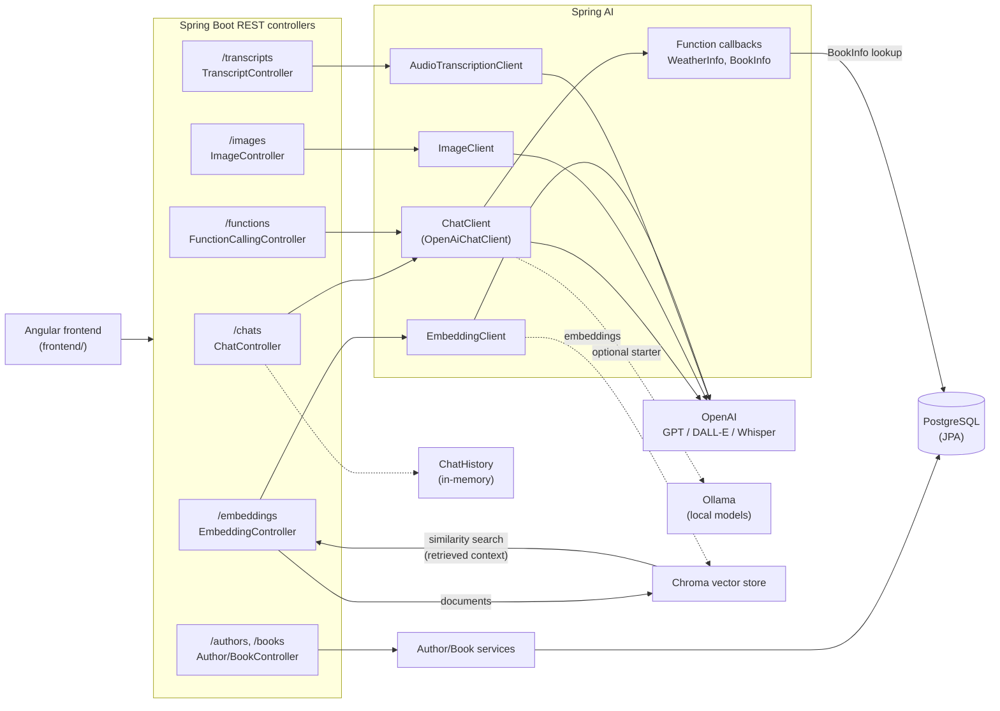

# AI Integration Spring Boot Backend

[](https://github.com/AZapata27/ai-integration-springai/actions/workflows/ci.yml)

A powerful Spring Boot backend for AI-powered applications that integrates various language models (LLMs), vector databases, and natural language processing capabilities.

## 🚀 Features

- **Basic Chat Interface**: Direct communication with AI models like GPT-4 and locally hosted models via Ollama
- **RAG (Retrieval Augmented Generation)**: Enhanced responses with context from your knowledge base
- **Function Calling**: Execute predefined Java functions from natural language prompts
- **Recommendation Engine**: Book and author recommendations based on chat history analysis
- **Image Generation**: AI-powered image creation from text descriptions
- **Speech-to-Text**: Audio transcription services

## 🛠️ Tech Stack

- **Framework**: Spring Boot 3.2+
- **AI SDKs**: 
  - Spring AI (for OpenAI, Ollama integration)
  - LangChain4j (for RAG, embeddings, function calling)
- **Vector Database**: Chroma DB
- **LLMs**: 
  - OpenAI GPT models (3.5/4)
  - Ollama (for local model deployment)
- **Database**: PostgreSQL (user data, chat history)
- **Authentication**: JWT-based auth
- **Documentation**: OpenAPI/Swagger

## 📋 Prerequisites

- Java 17+
- Maven 3.8+
- Docker & Docker Compose
- Chroma DB instance
- API keys for OpenAI (if using their services)
- Ollama setup (for local models)

## 🚦 Getting Started

1. **Clone the repository**
   ```bash
   git clone https://github.com/your-username/ai-integration-spring.git
   cd ai-integration-spring
   ```

2. **Configure environment variables**
   Copy the template used by Docker Compose and adjust the values:
   ```bash
   cp .env.example .env
   ```
   The application also expects `OPENAI_API_KEY` (and optionally `OLLAMA_API_URL`) in your shell environment.
   Never commit `.env`.

3. **Start the services**
   ```bash
   docker-compose up -d
   ```

4. **Build and run the application**
   ```bash
   mvn clean install
   mvn spring-boot:run
   ```

5. **Verify the setup**
   Open your browser and navigate to `http://localhost:8080/swagger-ui.html`

## 🔌 API Endpoints

### Chat Controllers
- `POST /api/chat/basic` - Basic chat with LLM
- `POST /api/chat/rag` - Enhanced chat with RAG

### Function Calling Controller
- `POST /api/function/call` - Execute functions via natural language

### Embedding Controller
- `POST /api/embedding/generate` - Generate embeddings
- `POST /api/embedding/search` - Search similar documents

### Recommendation Controller
- `GET /api/recommendations/books` - Get book recommendations
- `GET /api/recommendations/authors` - Get author recommendations

### Image Controller
- `POST /api/images/generate` - Generate images from text prompts

### Transcript Controller
- `POST /api/transcript/audio` - Convert audio to text

## 🏗️ Architecture



Requests from the Angular client hit the REST controllers, which delegate to Spring AI clients. Chat and function-calling go through `ChatClient` (OpenAI by default; Ollama can be enabled via its starter), and the model may call the registered Java functions (`WeatherInfo`, `BookInfo`). For RAG, documents are embedded and stored in Chroma, and similarity search returns the most relevant context. Authors and books are persisted in PostgreSQL through Spring Data JPA; conversation history is kept in memory.

## 📁 Project Structure

```
ai-integration-spring/
├── src/
│   ├── main/
│   │   ├── java/com/example/aiintegration/
│   │   │   ├── config/          # Configuration classes
│   │   │   ├── controller/      # REST controllers
│   │   │   ├── model/           # Entity classes
│   │   │   ├── repository/      # Data access
│   │   │   ├── service/         # Business logic
│   │   │   │   ├── ai/          # AI service implementations
│   │   │   │   ├── embedding/   # Embedding services
│   │   │   │   └── llm/         # LLM providers
│   │   │   ├── dto/             # Data transfer objects
│   │   │   └── util/            # Utility classes
│   │   └── resources/
│   │       ├── application.yml  # Application config
│   │       └── static/          # Static resources
│   └── test/                    # Test classes
├── .mvn/wrapper/                # Maven wrapper
├── docker-compose.yml           # Docker services
├── Dockerfile                   # Application container
├── pom.xml                      # Maven dependencies
└── README.md                    # This file
```

## 🔧 Configuration

### Vector Database Setup
The application uses Chroma DB as the vector database. Configure connection in `application.yml`:

```yaml
chroma:
  url: ${CHROMA_DB_HOST}:${CHROMA_DB_PORT}
  collection: ai-documents
```

### LLM Configuration
Configure multiple LLM providers:

```yaml
spring:
  ai:
    openai:
      api-key: ${OPENAI_API_KEY}
      chat:
        options:
          model: gpt-4
          temperature: 0.7
    ollama:
      base-url: ${OLLAMA_API_URL}
      chat:
        options:
          model: llama3
```

## 🧩 Extending the Application

### Adding New Functions for Function Calling
1. Create a new service with the function implementation
2. Register the function in `FunctionRegistry`
3. Add function metadata to the available tools

### Adding New RAG Sources
1. Create a document loader in the `repository` package
2. Implement the chunking strategy
3. Register the new source in the `EmbeddingService`

## 📊 Performance Considerations

- **Caching**: Implement Redis caching for frequently accessed embeddings
- **Async Processing**: Use Spring's async capabilities for non-blocking operations
- **Connection Pooling**: Configure proper database and HTTP client pooling

## 🛡️ Security

- All API endpoints are secured with JWT authentication
- LLM API keys are stored securely using environment variables
- Input validation and sanitization for all user inputs
- Rate limiting on sensitive endpoints

## 🤝 Contributing

1. Fork the repository
2. Create your feature branch (`git checkout -b feature/amazing-feature`)
3. Commit your changes (`git commit -m 'Add some amazing feature'`)
4. Push to the branch (`git push origin feature/amazing-feature`)
5. Open a Pull Request

## 📄 License

This project is licensed under the Apache 2.0 License - see the LICENSE file for details.
